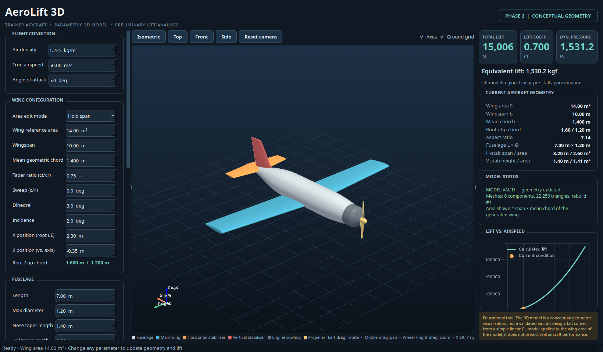
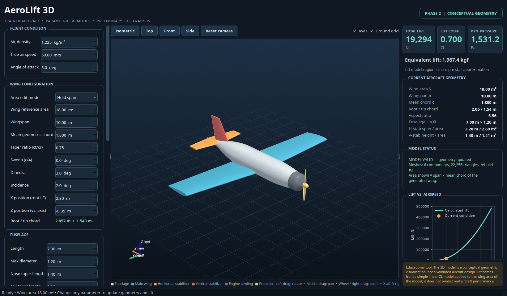
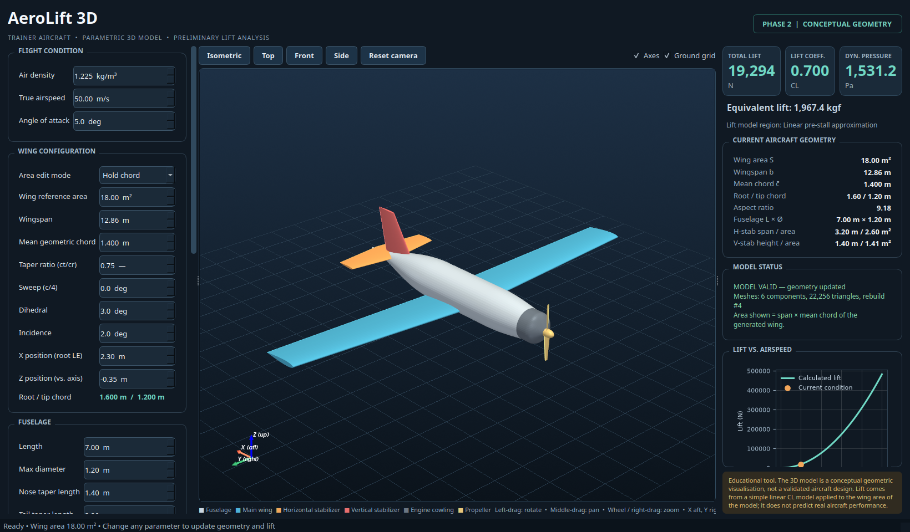
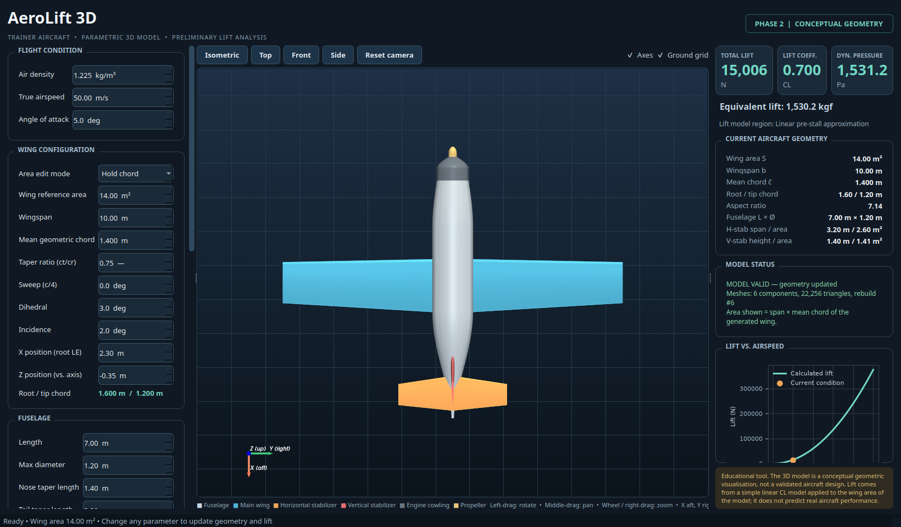

# AeroLift 3D

**Parametric 3D trainer-aircraft modelling with live preliminary lift analysis.**
Designed and developed by **Engineer Youssef Hosny Saad**.


-yellow)

AeroLift 3D is an educational desktop application. It builds a conceptual
single-engine, two-seat trainer aircraft as a set of parametric 3D components,
shows it in an interactive viewport embedded in the application window, and
recalculates the lift of the wing every time a dimension changes.



> **Engineering disclaimer.** The aircraft is a **conceptual, generic
> visualisation**, not a validated design. The lift model is a simplified
> teaching approximation (linear CL(α) capped at CLmax) and does **not**
> predict real aircraft performance. Do not use it for design, certification or
> flight-safety decisions. The 3D mesh is used for visualisation only; the lift
> calculation uses wing area, air density, airspeed and angle of attack.

---

## Features

- **Six independent parametric components:** fuselage, main wing, horizontal
  stabilizer, vertical stabilizer, engine cowling and a two-blade propeller with spinner.
- **Wing planform controls:** area, span, mean geometric chord, taper ratio,
  quarter-chord sweep, dihedral, incidence, and position relative to the fuselage.
- **Exact area relation:** `S = b · c̄ = b/2 · (c_root + c_tip)`. Area is derived
  from the geometry, so the number on screen always matches the mesh.
- **Two independent ways to change wing area:** hold the span (chord changes) or
  hold the chord (span changes).
- **Live update:** change a value and the 3D wing, the lift, CL, dynamic pressure
  and the chart update together. Other components are untouched.
- **Interactive 3D viewport:** rotate, pan, zoom, isometric / top / front / side
  views, reset camera, axes and ground grid.
- **Validation:** invalid geometry is reported in the interface, never crashes the
  app, and the model and results stay on the last valid configuration.
- **Clean architecture:** aerodynamics, aircraft parameters, geometry, rendering
  and GUI are separate modules.
- **Tested:** geometry unit tests and an automated GUI smoke test, including a
  repeated-rebuild memory check.

| Hold span (area 18 m²) | Hold chord (area 18 m²) |
|---|---|
|  |  |

## Quick start (Windows 11, PowerShell)

```powershell
git clone https://github.com/<your-username>/AeroLift3D.git
cd AeroLift3D
py -3.13 -m venv .venv
.\.venv\Scripts\Activate.ps1
python -m pip install --upgrade pip
pip install -r requirements.txt
python -m aerolift.app
```

If PowerShell blocks script activation, call the environment's Python directly:

```powershell
.\.venv\Scripts\python.exe -m pip install -r requirements.txt
.\.venv\Scripts\python.exe -m aerolift.app
```

Optional installable form (adds an `aerolift3d` launcher):

```powershell
pip install -e .
aerolift3d
```

Requirements: Python 3.10 or newer (developed for 3.13), Windows 10/11, and a
graphics driver with OpenGL support.

## Using the application

| Action | How |
|---|---|
| Rotate / pan / zoom | Left-drag / middle-drag / wheel or right-drag |
| Standard views | Isometric, Top, Front, Side buttons; Reset camera |
| Change wing area | Wing configuration → "Wing reference area" with **Area edit mode** = *Hold span* or *Hold chord* |
| Change span or chord directly | "Wingspan" or "Mean geometric chord" (area follows) |
| Restore the defaults | "Restore default aircraft" at the bottom of the left panel |

Type a value and press **Enter** (or use the arrows). The left panel scrolls.

## Coordinate convention

Right-handed system, SI units (metres; angles in degrees).

| Axis | Meaning |
|---|---|
| **X** | Longitudinal, positive **aft**. The nose is at X = 0 (fuselage-station convention); the engine and propeller are at X < 0 |
| **Y** | Lateral, positive to the pilot's **right** (starboard) |
| **Z** | Vertical, positive **up**; fuselage centreline at Z = 0 |



## Project structure

```text
AeroLift3D/
├── aerolift/
│   ├── __init__.py
│   ├── app.py              GUI: main window, panels, signal wiring
│   ├── aerodynamics.py     Lift engine: L = 1/2 rho V^2 S CL (Phase 1)
│   ├── aircraft_model.py   Parameter dataclasses, wing relations, validation
│   ├── geometry.py         Parametric mesh generation (PyVista PolyData)
│   └── visualization.py    Embedded 3D viewport and scene management
├── tests/
│   ├── test_geometry.py    Unit tests, no GUI required
│   └── gui_smoke_test.py   Drives the real window and saves screenshots
├── docs/
│   ├── TUTORIAL.md         Step-by-step design tutorial and library guide
│   └── images/
├── .github/workflows/ci.yml
├── pyproject.toml
├── requirements.txt
├── requirements-dev.txt
├── CHANGELOG.md
├── CONTRIBUTING.md
├── LICENSE
└── README.md
```

| Module | Responsibility | Depends on |
|---|---|---|
| `aerodynamics.py` | Lift, CL model, dynamic pressure; no GUI, no geometry | stdlib only |
| `aircraft_model.py` | Dimensions of every component, area relations, validation | stdlib only |
| `geometry.py` | Turns parameters into 3D meshes | `aircraft_model`, NumPy, PyVista |
| `visualization.py` | Owns the viewport, actors and cameras | PyVista, PyVistaQt, PySide6 |
| `app.py` | Controls, results, wiring | all of the above, Matplotlib |

`aerodynamics` and `geometry` never import each other. Only `app.py` connects
them, passing the single wing area from `AircraftConfig` to the lift calculation.

## Technology stack

| Library | Role |
|---|---|
| [PySide6](https://doc.qt.io/qtforpython-6/) | Windows desktop GUI (Qt 6) |
| [PyVista](https://docs.pyvista.org/) | Mesh creation and 3D rendering (on top of VTK) |
| [PyVistaQt](https://qtdocs.pyvista.org/) | Embeds the PyVista render window in a Qt widget |
| [NumPy](https://numpy.org/) | Numerical arrays for geometry |
| [Matplotlib](https://matplotlib.org/) | Lift-versus-airspeed chart |

A detailed explanation of each library, and of how the application was designed
step by step, is in **[docs/TUTORIAL.md](docs/TUTORIAL.md)**.

## Testing

```powershell
pip install -r requirements-dev.txt
python -m unittest tests.test_geometry -v      # headless geometry tests
python -m tests.gui_smoke_test shots           # opens the window, saves screenshots to .\shots
```

The geometry tests verify that:
- the generated wing and stabilizer meshes match their declared planform area;
- both area-editing modes change the correct dimension;
- editing the wing leaves every other component unchanged;
- invalid input (zero/negative span or chord, bad taper, `NaN`, impossible fuselage) is rejected;
- 200 repeated rebuilds do not grow memory or Python object counts.

The GUI smoke test launches the real window, rotates the camera, edits wing area
in both modes and the wingspan, checks that the mesh and lift update, submits
invalid input, cycles all views, and performs 150 live rebuilds while monitoring
memory and actor count. On Linux without a display, run it under `xvfb-run`.

## Default aircraft

| Item | Value |
|---|---|
| Wing | S = 14 m², b = 10 m, c̄ = 1.4 m, taper 0.75, dihedral 3°, incidence 2° |
| Fuselage | 7.0 m long, 1.2 m maximum diameter |
| Horizontal stabilizer | 3.2 m span, 2.6 m² |
| Vertical stabilizer | 1.4 m high, 1.3 m root chord |
| Propeller | 1.75 m diameter, two blades |

These are generic illustrative values, not those of a specific aircraft.

## Known limitations

- Symmetric NACA-00xx-style sections only; no camber, canopy, landing gear,
  flaps, fillets or control surfaces.
- The wing passes through the fuselage with no boolean union or root fairing.
- The propeller is static and its twist is visual only.
- Wing area is the projected planform area, so dihedral does not change S.
- The lift model has no finite-wing, downwash, tail-load, Reynolds/Mach,
  ground-effect or post-stall behaviour; sweep, taper and incidence do not
  alter CL.
- Tail positions are manual; there is no stability or trim sizing.
- Lift-vector visualisation and other Phase 3 features are not implemented.

## Roadmap

- **Phase 3:** lift-vector visualisation, additional aerodynamic outputs.
- Wing–fuselage blending, canopy and landing gear.
- STL export of the generated model.

## Contributing

See [CONTRIBUTING.md](CONTRIBUTING.md). Version history is in [CHANGELOG.md](CHANGELOG.md).

## License

Released under the [MIT License](LICENSE). The educational disclaimer above
applies to all use of this software.

## Author

**Engineer Youssef Hosny Saad** — design and development of AeroLift 3D.
